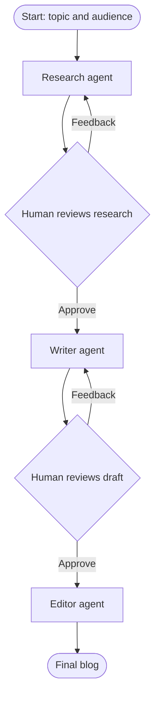

# Multi-Agent Blog Generator

Multi-Agent Blog Generator uses a coordinated set of language-model agents to research a topic, draft a blog post, and polish the result. A person reviews the research and the draft at workflow pauses before the final version is produced.

## Agent design and screenshots

> **Screenshot placeholder:** Add a screenshot of the agent design or workflow here when it is available.
>
> To include it, save the image as `docs/images/agent-design.png` and replace this placeholder with:
> ``

## Overview

The project is a Python/Jupyter notebook prototype. Its end-to-end example is [`app.ipynb`](./app.ipynb), which builds and invokes the LangGraph workflow. It is not currently a web application or command-line application.

### What it does

1. Accepts a blog topic and intended audience.
2. Asks a research agent for a structured outline with key points and examples.
3. Pauses for human review of the outline. Approve it or provide feedback for another research pass.
4. Asks a writing agent to create a Markdown draft based on the approved research.
5. Pauses for human review of the draft. Approve it or provide feedback for a rewrite.
6. Sends the approved draft to an editor agent for a final polish.
7. Returns the final blog text in the notebook.

The example prompts request a research outline with 5–7 key points and a 500–800 word blog with a title, introduction, 3–5 sections, and conclusion. These are model instructions, not programmatically enforced constraints.

### Workflow



Human review is implemented with LangGraph interrupts. The notebook resumes the paused graph with `Command(resume=...)`; review decisions are therefore made by running the relevant notebook cells.

## Technology stack

| Technology | Purpose |
| --- | --- |
| Python | Application language |
| LangChain | LLM integration and prompt chains |
| `langchain-groq` / Groq API | Chat model provider |
| LangGraph | Stateful workflow, routing, and human-review interrupts |
| `InMemorySaver` | In-process graph checkpointing for notebook runs |
| Pydantic | Workflow state model |
| `python-dotenv` (provided by the `dotenv` dependency) | Loads the API key from `.env` |
| Jupyter Notebook / IPython | Interactive execution and display of the examples |

The model defaults to `openai/gpt-oss-20b` through Groq and uses temperature `0.5`. The notebook can be edited to change the topic, audience, or model parameters.

## Repository structure

```text
.
├── README.md
├── requirements.txt
├── .env.example
├── app.ipynb
└── blog-generator-agent/
    ├── agent.py
    ├── graph.py
    ├── state.py
    └── blog_notebook.ipynb
```

- [`blog-generator-agent/agent.py`](./blog-generator-agent/agent.py): creates the Groq chat model and defines the research, writing, and editing prompts and agent functions.
- [`blog-generator-agent/state.py`](./blog-generator-agent/state.py): defines `BlogState`, including topic, audience, agent outputs, review feedback, and revision metadata.
- [`blog-generator-agent/graph.py`](./blog-generator-agent/graph.py): defines the LangGraph nodes and conditional routes, human-review pauses, and in-memory checkpointer.
- [`app.ipynb`](./app.ipynb): end-to-end workflow example. It loads `.env`, adds the source folder to the Python import path, starts a workflow, reads interrupt payloads, resumes with approval or feedback, and displays the final blog.
- [`blog-generator-agent/blog_notebook.ipynb`](./blog-generator-agent/blog_notebook.ipynb): smaller example for loading the environment and invoking the model and research agent directly.
- [`requirements.txt`](./requirements.txt): Python package dependencies used by the project.
- [`.env.example`](./.env.example): environment-variable template. Copy it to `.env` and set your own Groq API key.
- [`.gitignore`](./.gitignore): excludes `.env` and the local `venv` directory from Git.

## Requirements

- Python 3.10 or newer.
- A Groq API key with access to the configured model.
- Internet access while calling the Groq API.
- Jupyter Notebook to run the notebooks. Jupyter is not currently listed in `requirements.txt`, so install it separately as shown below.

## Run locally

Run the following commands from the repository root.

### 1. Create and activate a virtual environment

**Windows PowerShell**

```powershell
py -3 -m venv venv
.\venv\Scripts\Activate.ps1
```

If PowerShell blocks activation, either allow script activation for your user according to your organization's policy or use Command Prompt:

```bat
venv\Scripts\activate.bat
```

**macOS / Linux**

```bash
python3 -m venv venv
source venv/bin/activate
```

### 2. Install dependencies

```bash
python -m pip install --upgrade pip
python -m pip install -r requirements.txt
python -m pip install jupyter ipykernel
```

### 3. Configure the Groq API key

Copy `.env.example` to `.env` in the repository root, then replace the empty value with your key:

```dotenv
GROQ_API_KEY=
```

For example, the completed file should contain `GROQ_API_KEY=your_groq_api_key` (use your actual key, without the example text). Keep the key private: do not commit `.env`, share it, or put it in a notebook cell. The repository's `.gitignore` excludes `.env`.

### 4. Start Jupyter from the repository root

```bash
python -m ipykernel install --user --name blog-generator-agent --display-name "Python (Blog Generator Agent)"
python -m jupyter notebook
```

Open [`app.ipynb`](./app.ipynb), select the **Python (Blog Generator Agent)** kernel, and run the cells in order. The notebook's imports use the relative path `./blog-generator-agent`, so starting Jupyter from the repository root is important.

The graph pauses at the research-review and draft-review steps. Inspect the displayed interrupt payload, then run the corresponding resume cell with approval or your feedback. To customize the example, edit its topic, audience, or resume payloads. Run [`blog-generator-agent/blog_notebook.ipynb`](./blog-generator-agent/blog_notebook.ipynb) for the smaller direct model/research example.

## Current implementation notes

- Graph checkpoints use `InMemorySaver`; checkpointed conversations are held in process memory and are not persisted after the Python process exits.
- A `thread_id` identifies each workflow in the end-to-end notebook. Use a new ID for an independent run.
- Human review is demonstrated in Jupyter, not exposed through a standalone UI or API.
- The graph declares a maximum draft-revision count, but the current code does not increment the state's `revision_count`. As a result, the intended limit is not enforced and draft feedback can continue routing to the writer.
- The notebooks contain saved cell outputs; those outputs may not match a new run or current model responses.


## Code review observations

- The draft revision limit is ineffective because `revision_count` is initialized but not incremented in the workflow.
- In the writer's no-feedback case, the intended first-attempt message is assigned to `revision_hints` rather than `revision_hits`; the prompt continues to receive the feedback wording initialized above it. This does not prevent the call but gives the model misleading first-draft instructions.
- The manifest names the deprecated `dotenv` package rather than declaring `python-dotenv` directly. The current dependency provides `python-dotenv` transitively, but declaring the directly imported package would be clearer and less fragile.
- The repo has no automated test suite or non-notebook application entry point at present.
